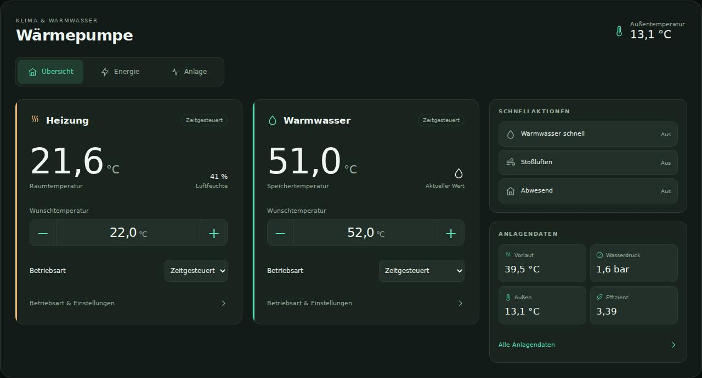
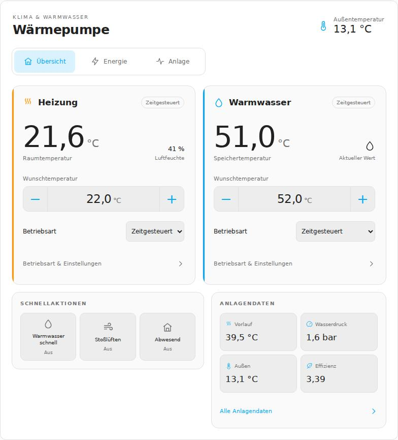
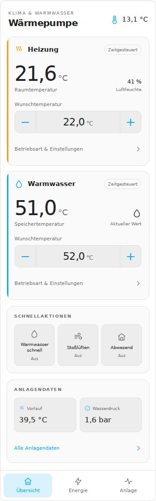
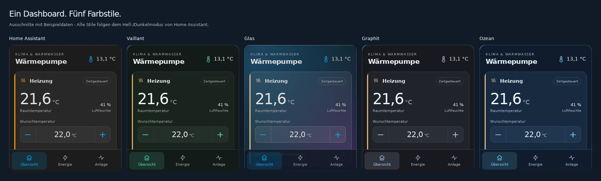

# Vaillant App Card

**English** | [Deutsch](README.de.md)

[](#installation)
[](https://www.home-assistant.io/dashboards/)
[](https://github.com/kafast/ha-vaillant-card/issues)

Control your Vaillant heating and hot water from your Home Assistant dashboard, with layouts for **phones, tablets and desktops**. The card uses your Home Assistant theme by default and offers additional color schemes inspired by myVAILLANT.

Entities from the [myVAILLANT integration](https://github.com/signalkraft/mypyllant-component) are discovered automatically. Start with one line of YAML; no additional custom cards or themes are required.

> [!WARNING]
> **AI-generated / experimental:** This code was created and revised with generative AI. It has not been comprehensively tested or validated on a physical heating system. Automated checks with simulated data do not replace testing on real equipment.
>
> Controls send real commands. Verify entity assignments, readings and the effects of changes on your own system before relying on them. This card is not a safety monitoring system and must not be your only source of fault or frost-protection alerts. Back up your dashboard configuration before updating. This is an independent community project, without endorsement or support from Vaillant or the Home Assistant project.

**Add to Home Assistant**

[](https://my.home-assistant.io/redirect/hacs_repository/?owner=kafast&repository=ha-vaillant-card&category=plugin)

Opens this repository in HACS on your Home Assistant instance. HACS must already be installed; download the card afterward. This dashboard card does not replace the myVAILLANT integration.



*Screenshots use invented data and German UI labels. No physical heating system is connected. The card supports English and German.*

<details>
<summary>Tablet and phone previews</summary>

**Tablet:** Side-by-side controls, with quick actions and system readings below.



**Phone:** Stacked controls, inline temperature adjustments and bottom navigation.



</details>

## Features

| View | Features |
| --- | --- |
| Overview | Current temperatures, inline heating and hot-water setpoints, quick actions and selected readings |
| Heating | Current and target temperature, operating mode, links to schedule, heating curve and Quick Veto duration |
| Hot water | Tank temperature, setpoint, operating mode and hot-water boost |
| Quick actions | Hot-water boost, ventilation boost and away mode |
| Energy | Electrical consumption, environmental energy, generated heat and efficiency; hydraulic station shown separately |
| System | Connectivity, faults, system readings and missing-entity information |

- Registry-based discovery continues to work with renamed entity IDs.
- Selection for multiple systems, zones, tanks or energy devices.
- Local YAML overrides for individual entities.
- Layout follows the available card width.
- Five color schemes and automatic light/dark mode following Home Assistant.
- Visual editor for labels, language, scheme and optional accent colors.
- English and German UI, automatically selected from the Home Assistant language.

## Requirements

- Home Assistant with support for custom dashboard cards.
- The configured [myVAILLANT integration by signalkraft](https://github.com/signalkraft/mypyllant-component), platform `mypyllant`.
- Enabled entities for the required functions, particularly `climate` for heating and `water_heater` for hot water.
- Access to the HA entity registry in the current session for automatic discovery.
- Optional: [HACS](https://www.hacs.dev/) for installation and updates.

Available functions depend on your equipment, integration and enabled entities. A minimum supported HA version has not been established. Current validation uses simulated data.

## Installation

### HACS (recommended)

This is a **custom dashboard repository**, not a listing in the default HACS catalog.

1. Open **HACS → ⋮ → Custom repositories**.
2. Enter `https://github.com/kafast/ha-vaillant-card`.
3. Select **Dashboard** and add the repository.
4. Find **Vaillant App Card** in HACS and download it.
5. Reload the Home Assistant frontend.

HACS normally manages the resource automatically. If missing under **Settings → Dashboards → Resources**, add the following as a **JavaScript module**:

```text
/hacsfiles/ha-vaillant-card/vaillant-app-card.js
```

### Manual installation

1. Download [`vaillant-app-card.js`](https://raw.githubusercontent.com/kafast/ha-vaillant-card/main/vaillant-app-card.js).
2. Copy it to `/config/www/vaillant-app-card.js`; create `www` if needed.
3. Under **Settings → Dashboards → Resources**, add `/local/vaillant-app-card.js?v=1.4.0` as a **JavaScript module**.
4. Reload the frontend.

Enable advanced mode in your user profile if Resources is hidden. A newly created `www` directory may require an HA restart before its files become accessible.

<details>
<summary>YAML-managed resources</summary>

Add to the existing resource configuration:

```yaml
lovelace:
  resources:
    - url: /local/vaillant-app-card.js?v=1.4.0
      type: module
```

Do not duplicate an existing `lovelace:` section. Manage resources through your chosen YAML setup or the UI.

</details>

> [!IMPORTANT]
> When switching between manual installation and HACS, remove the previous resource entry. Load the JavaScript file only once.

## Quick start

Edit your dashboard → **Add card → Manual**, then paste:

```yaml
type: custom:vaillant-app-card
```

The card searches for matching myVAILLANT entities. Multiple possible systems or zones produce a selection. Use plus/minus to adjust setpoints directly in the overview; **Mode & settings** opens the corresponding detail view.

## Phone, tablet and desktop layouts

The **available card width** determines the layout. A narrow desktop dashboard column still uses the compact layout.

| Card width | Layout |
| --- | --- |
| Below 620 px | Stacked controls, large temperature buttons, compact quick actions, two system readings and bottom navigation |
| 620–1049 px | Side-by-side heating and hot water, quick actions and readings below, top navigation |
| 1050 px and above | Two controls with a sidebar for actions and readings; multi-column energy and system views |

Operating modes are directly accessible in the wider overview. Narrow layouts expose them through **Mode & settings**. Light/dark mode follows the mode reported by HA.

In a **Sections** dashboard, use the layout dialog to give the card the full section width, and widen the section for more room. A dedicated **Panel** view can give one card the available dashboard width:

```yaml
# Add to the existing dashboard views list:
- title: Heat pump
  path: heat-pump
  type: panel
  cards:
    - type: custom:vaillant-app-card
```

This is a complete view entry, not the configuration of an individual manual card. Preserve existing views.

## Colors and themes



Open **Edit card → Show visual editor → Color scheme**. Optional hex accent colors are also available there. Other configuration options remain available in YAML.

| Scheme | `color_scheme` | Appearance |
| --- | --- | --- |
| Home Assistant | `home_assistant` | Uses the active HA theme for backgrounds, text, accents and borders; default |
| Vaillant | `vaillant` | Greens with warm heating accents |
| Glass | `glass` | Transparent surfaces, blur and theme accent |
| Graphite | `graphite` | Neutral grays and subtle lavender accents |
| Ocean | `ocean` | Blues with light-blue accents |

All schemes follow HA light/dark mode. An explicitly configured scheme takes precedence.

```yaml
type: custom:vaillant-app-card
color_scheme: home_assistant
```

The default uses variables including `--ha-card-background`, `--card-background-color`, `--primary-text-color`, `--secondary-text-color`, `--primary-color` and HA border variables.

### Glass appearance

```yaml
type: custom:vaillant-app-card
color_scheme: glass
```

A dashboard background makes transparency more visible. The card respects `--ha-card-glass-tint`, `--ha-card-backdrop-filter` and `--ha-card-border-radius`, with built-in transparent surfaces and blur as defaults. No `card-mod` or extra card is required. Browsers without backdrop-filter support receive an opaque fallback.

An installed glass theme may also work well with `home_assistant`, which inherits its backgrounds and colors. The result depends on the theme's variables.

### Custom accents

```yaml
type: custom:vaillant-app-card
color_scheme: home_assistant
accent_color: "#03a9f4"
heating_color: "#ff9800"
```

`accent_color` controls general accents and active elements; `heating_color` controls heating accents. Hex values may have 3, 4, 6 or 8 digits. Quote them in YAML because `#` starts a comment. Remove an option or clear its editor field to restore the scheme default.

## Configuration

Use the visual editor for labels, language and colors. Entity assignments and fixed system indices require YAML.

| Option | Type | Default | Description |
| --- | --- | --- | --- |
| `type` | String | required | `custom:vaillant-app-card` |
| `title` | String | localized | Card heading; custom text is preserved |
| `zone_name` | String | localized | Heating view name; custom text is preserved |
| `language` | String | `auto` | HA language; override with `de` or `en`. Other HA languages fall back to English. |
| `color_scheme` | String | `home_assistant` | `home_assistant`, `vaillant`, `glass`, `graphite`, `ocean` |
| `accent_color` | String | scheme/theme | Optional general accent hex color |
| `heating_color` | String | scheme/theme | Optional heating accent hex color |
| `auto_discover` | Boolean | `true` | Enable automatic matching |
| `system_id` | String | automatic | Select a specific myVAILLANT system |
| `config_entry_id` | String | all myVAILLANT entries | Restrict discovery to one integration entry |
| `zone` | Integer | automatic/selection | Technical heating-zone index |
| `circuit` | Integer | automatic/selection | Technical heating-circuit index |
| `water` | Integer | automatic/selection | Technical hot-water tank index |
| `energy_device_id` | String | automatic/selection | HA device ID for energy readings |
| `entities` | Object | `{}` | Override individual assignments |

### Language and custom labels

```yaml
type: custom:vaillant-app-card
language: en
title: Heating and hot water
zone_name: Ground floor
```

Without an override, the UI follows HA's language, supporting German and English with English as fallback. Source messages, identifiers and comments are English; German UI text is held in a separate translation dictionary. Custom labels and entity values are preserved.

### Fixed zone and circuit

```yaml
type: custom:vaillant-app-card
zone: 1
circuit: 0
water: 0
```

These are example indices. Match them to your integration; technical indices may differ from visible zone numbers. YAML choices persist across reloads. Dropdown choices apply to the current card instance.

### Entity overrides

```yaml
type: custom:vaillant-app-card
entities:
  room: sensor.example_room_temperature
  outdoor: sensor.example_outdoor_temperature
```

Local assignments override discovery. `null` disables an assignment but does not automatically hide the corresponding UI element.

<details>
<summary>All entity assignment keys</summary>

| Area | Keys |
| --- | --- |
| Controls | `climate`, `water_heater` |
| Room and outdoors | `room`, `humidity`, `outdoor` |
| Targets and mode | `heating_target`, `heating_mode`, `water_target` |
| Flow and tank | `flow`, `flow_target`, `system_flow`, `tank` |
| System state | `pressure`, `online`, `trouble`, `operating_state`, `circuit_state` |
| Quick actions | `boost`, `ventilation`, `away` |
| Heating settings | `heating_curve`, `veto_duration` |
| Calendars | `heating_calendar`, `water_calendar`, `circulation_calendar` |
| Electrical energy | `electric_heating`, `electric_water` |
| Environmental energy | `environment_heating`, `environment_water` |
| Generated heat | `heat_heating`, `heat_water` |
| Hydraulic station | `hydraulic_electric`, `hydraulic_heat` |
| Efficiency and firmware | `efficiency`, `firmware`, `firmware_update` |

Values are entity IDs from your own HA installation. Keep private assignments in local dashboard YAML, not public examples.

</details>

<details>
<summary>Fully manual setup</summary>

```yaml
type: custom:vaillant-app-card
auto_discover: false
entities:
  climate: climate.example_heating
  water_heater: water_heater.example_hot_water
```

Add other assignments using the keys above. All example entity IDs are invented.

</details>

## Automatic matching

The card reads HA's entity registry and filters for platform `mypyllant`. Integration identifiers match heating, hot water and sensor entities without private IDs in the source code.

Energy matching uses original integration names, independently of renamed entity IDs or custom display names. Multiple energy devices require a selection; their measurements are not arbitrarily added together.

Disabled entities may be discovered but provide no state. Discovery does not enable them. Missing readings show “—” or a notice; controls without an active control entity remain disabled.

After adding or renaming an entity, use **System → Discover entities again**. State changes arrive over the existing HA connection. The card does not request additional Vaillant cloud refreshes.

## Controls and limitations

| Feature | Behavior |
| --- | --- |
| Plus/minus | Available in overview and details; sends a real target-temperature change. Limits and steps come from the entity. Fallback steps: 0.5 °C for heating and 1 °C for hot water. |
| Operating mode | Uses modes reported by the entity. `heat_cool` is labeled “Manual” according to the myVAILLANT mapping. |
| Quick Veto | In scheduled operation, a temperature change may be temporary. The card does not automatically change its duration. |
| Heating curve / other settings | Opens HA entity details. |
| Weekly schedule / circulation | Opens calendar entity details. Edit schedules in the HA calendar using weekly recurrence; no built-in schedule editor. |
| Energy | Current sensor values with Wh/kWh/MWh conversion. No monthly/yearly analysis; hydraulic station shown separately. |

A successfully sent command does not confirm that the equipment applied it. The card waits for a state update. If a temperature is not confirmed within 45 seconds, it returns to the reported value and shows a notice.

## Updates

**HACS:** Download available updates from the card's HACS page. Refresh repository information and redownload if needed, then reload the frontend.

**Manual:** Replace the JavaScript file and change the resource URL's version parameter to invalidate the browser cache.

- **1.4.0:** English source messages; English/German UI, editor language selection and bilingual documentation. Prominent AI-generation and test-limit notices.
- **1.3.1:** Home Assistant is the default scheme, including in the editor. Set `color_scheme: vaillant` for the earlier appearance.
- **1.3.0:** Five color schemes, theme colors, glass appearance and visual editor.
- **1.2.0:** Responsive views, inline overview controls, adapted navigation and light/dark mode.
- **1.1.0:** Removed fixed installation IDs. Existing local `entities` overrides retain precedence.

## Troubleshooting

| Problem | Check / solution |
| --- | --- |
| `Custom element doesn't exist: vaillant-app-card` | Check resource URL, JavaScript module type and file access; reload the frontend and clear browser cache if needed. |
| No system found | Check that the myVAILLANT integration is loaded and uses `mypyllant`; select a system if prompted. |
| Automatic matching fails | Retry discovery. If the session cannot read the registry, use local `entities` assignments. |
| Missing values / “—” | Filter **Settings → Devices & services → Entities** for myVAILLANT, show disabled entities and enable those required. |
| Disabled temperature buttons | Check control entity availability, temperature support, limits, pending commands and offline state. |
| Old UI after updating | Redownload in HACS, reload the frontend, check cache and remove duplicate resources. |
| Missing or stale energy data | Check energy entities directly in HA and select the energy device if prompted. Periods and refresh rates depend on the integration. |
| Compact desktop layout | Card width is below 620 px; widen the section or use a panel view. |
| New scheme/editor missing | Redownload the current version and check frontend cache and old resources. |
| Glass looks opaque | Select `glass`, use a dashboard background and check theme tint/blur overrides. Unsupported browsers use an opaque fallback. |
| Selection lost after reload | Configure the desired system, zone or device in local YAML. |
| Wrong language | Use `language: de` or `language: en`; `auto` follows HA and falls back to English for unsupported languages. |

## Privacy

Discovery runs inside the current authenticated HA browser session. Assignments are held in memory, not local browser storage. The card sends no equipment data to GitHub or an additional service. HA's and myVAILLANT's own storage and cloud behavior remain separate.

Current source contains no personal entity IDs, system IDs, serial numbers, readings or credentials from a specific installation. Tests and previews use example data. Earlier commits may retain earlier content.

## Development and support

No extra runtime libraries are required. Run:

```sh
node --test tests/discovery.test.cjs
node --check vaillant-app-card.js
```

Simulated checks cover discovery, independent temperature confirmations, service targets, container layouts, color schemes, the editor and browser rendering. Layouts have been checked at 320, 390, 820 and 1400 px viewport widths and with a narrow card in a wide desktop window. Language checks cover selection, fallback, labels and preserved custom names. **These checks are limited and do not establish compatibility with every HA version, browser, theme or heating system. Physical-system validation remains outstanding.**

Report bugs and improvements through [GitHub Issues](https://github.com/kafast/ha-vaillant-card/issues). Include HA, integration and card versions, plus reproduction steps. Remove private IDs, serial numbers, credentials and personal information from logs and screenshots first.

### Interfaces and design references

- [Home Assistant custom cards](https://contributors.home-assistant.io/frontend/custom-ui/card/)
- [HA entity registry](https://github.com/home-assistant/core/blob/dev/homeassistant/components/config/entity_registry.py)
- [myVAILLANT integration](https://github.com/signalkraft/mypyllant-component)
- Design inspired by myVAILLANT; no official Vaillant image files or logos included.
